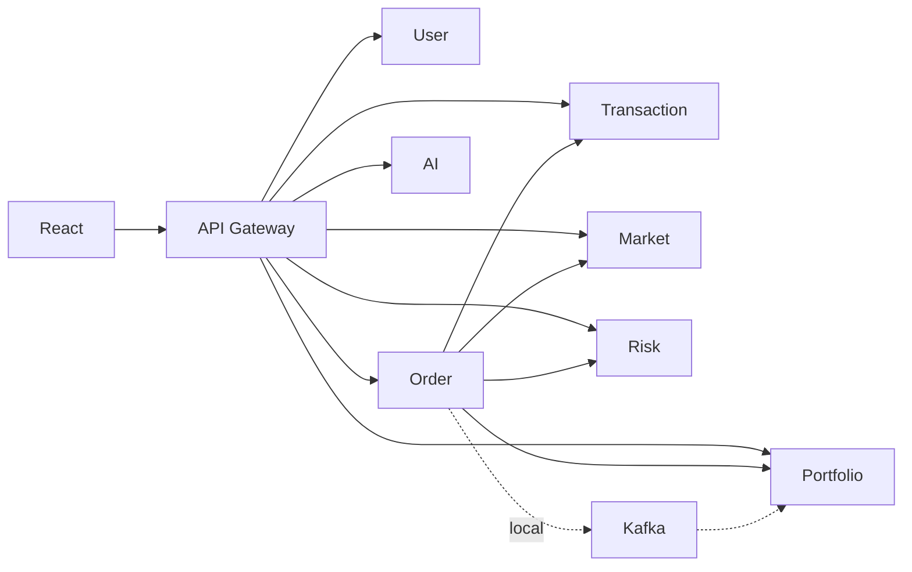
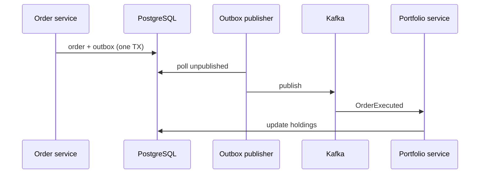

# FinPilot — system design & interview notes

This is a cheat sheet for **your** project: what you actually built, how you’d explain it in an interview, and what you’d add next. Concepts are grouped in twelve areas (plus a question bank). When something isn’t in the repo yet, it’s called out explicitly so you don’t oversell.

---

## 1. High-level architecture

**What runs where**

The React app talks only to the **API gateway** (`:8080`). The gateway validates JWTs and routes by path to seven Spring Boot services. Locally they’re separate JVMs on fixed ports; on Render they share one container and still call each other over `http://127.0.0.1:808x`.

| Piece | Role in FinPilot |
| ----- | ---------------- |
| API gateway | Single public URL, JWT check, CORS, reverse proxy |
| user-service | Login, users, cash accounts (not a standalone “auth microservice”) |
| portfolio-service | Portfolios, holdings, valuation reads |
| order-service | Order orchestration (sync calls to risk, quotes, ledger, portfolio) |
| transaction-service | Reserve / settle / release + ledger lines |
| market-data-service | Simulated quotes |
| risk-service | Rule-based approve/deny |
| ai-service | Portfolio Q&A, RAG-ish retrieval, engineering PR review endpoint |
| Kafka | Local async: order created/executed, portfolio updates via consumers |
| Redis | Local: quote and portfolio summary cache (JSON serialization) |
| PostgreSQL | One schema — users, accounts, orders, ledger, outbox |

**Why microservices here (short interview answer)**

“I split by **change rate and blast radius**, not because I needed nine teams. Money paths stay in order + transaction; UI-heavy stuff can move faster. The cost is distributed workflows — I paid that with explicit reserve/settle, idempotency keys, and either Kafka + outbox locally or a synchronous portfolio callback in prod.”

---

## 2. Database design

**Source of truth:** Flyway `V1__schema.sql` on user-service (shared DB). Normalized tables: `users`, `accounts`, `portfolios`, `holdings`, `orders`, `transactions`, `ledger_entries`, `outbox_events`, `knowledge_chunks`.

**Concepts you can point at**

- **Referential integrity** — FKs from orders → users/portfolios/assets.
- **ACID** — reserve/settle happen inside `@Transactional` in `LedgerService`.
- **Idempotency** — unique `(user_id, idempotency_key)` on orders; unique `idempotency_key` on transactions.
- **Optimistic locking** — `accounts.version` column (available for concurrent updates).
- **Pessimistic locking** — `AccountRepository.findCashForUpdate` (`PESSIMISTIC_WRITE`) when reserving cash so two ₹35k buys on ₹50k cannot both pass.
- **Migrations** — Flyway in prod; local can use the same migrations via Docker Postgres.

**Double-spend story (₹50k, two ₹35k orders)**

Order A grabs the cash row with `SELECT … FOR UPDATE`, moves ₹35k from available → reserved. Order B blocks on the same row, then sees insufficient **available** balance and gets rejected. Without that lock, two threads could both read ₹50k available.

---

## 3. Distributed systems (as implemented)

| Idea | In FinPilot |
| ---- | ----------- |
| Strong consistency (cash) | Same DB transaction around account + ledger lines |
| Eventual consistency (holdings) | Kafka path: portfolio updates after `OrderExecuted`; prod sync path: HTTP `buy-execution` in the same order request |
| Idempotency | Client `Idempotency-Key` header + DB uniqueness |
| Saga / compensation | Order `try/catch`: on failure after reserve → `release` on transaction service |
| No 2PC | Orchestration in order-service, not XA |
| Timeouts / circuit breakers | Basic WebClient calls; **no Resilience4j yet** — say that if asked |
| CAP (pragmatic) | Postgres = CP for money; cached quotes = AP-ish, stale-by-TTL acceptable |

**Render vs local:** `finpilot.events.kafka-enabled=false` turns off outbox publishers and Kafka listeners; portfolio is updated by direct HTTP. That trades decoupling for operability on a small host.

---

## 4. Events — Kafka & outbox

**Local happy path (buy)**

1. Order-service validates, reserves, executes (simulated).
2. Same request writes rows to `outbox_events` (when Kafka enabled).
3. Scheduled `OutboxPublisher` sends to topics (`finpilot.order-created`, `finpilot.order-executed`, etc.).
4. Portfolio consumer applies holdings update.

**Patterns to name**

- **Transactional outbox** — business row and outbox insert commit together; publisher is async.
- **At-least-once** — Kafka + retries; consumers should be idempotent (portfolio updates keyed by order id in practice).
- **Choreography** — no central saga engine; services react to events (portfolio listener).

**Not built (yet):** Dead-letter queue, schema registry, exactly-once end-to-end.

---

## 5. Financial design (your differentiator)

**Balances**

- `available_balance` — spendable cash  
- `reserved_balance` — earmarked for open buys  
- Reserve moves money available → reserved; settle burns reserved and posts ledger; release puts it back on failure.

**Ledger**

`LedgerService` writes balanced debit/credit pairs (`ledger_entries`) tied to a `transactions` row — not “only tweak a balance column.”

**Order lifecycle (states in DB)**

`CREATED` → `VALIDATED` → `RESERVED` → `EXECUTED` or `REJECTED` / `FAILED`.

**AI boundary**

AI service reads portfolio/context and calls Gemini (optional). It has **no** API into `POST /internal/ledger/*`. That’s intentional: explanations can be wrong; money cannot be wrong.

---

## 6. Caching

**Local:** Redis via Spring Cache on quotes (`market-data-service`) and portfolio summaries (`portfolio-service`), with Jackson JSON (including Java time).

**Prod (Render):** `finpilot.cache.mode=simple` — in-process `ConcurrentMapCacheManager`. Fine for a demo; **not** shared across instances.

**Interview line:** “Quotes are cache-aside: read Redis, on miss compute/fetch, set TTL. Balances never live in Redis as source of truth — only Postgres after reserve/settle.”

**Not built:** stampede protection, write-through, explicit TTL docs in code for all caches.

---

## 7. Security

**What you have**

- BCrypt password hashes (user-service)
- JWT issued at login; gateway `JwtAuthFilter` rejects missing/invalid tokens (except `/api/v1/auth/**`, actuator)
- User id passed downstream via headers (`X-User-Id` pattern in commons)
- CORS on gateway for Vercel origins
- Parameterized SQL / JPA on most paths; order insert uses prepared statements in `OrderPersistHelper`

**What you should admit you skipped**

- Refresh tokens  
- Per-service mTLS  
- Gateway rate limiting  
- Full RBAC enforcement on every endpoint (roles exist in schema; not every path checks them)  
- Correlation IDs across services  

**Financial API habits you *did* bake in:** idempotency keys, internal ledger only on transaction-service, simulated trading disclaimer.

---

## 8. Scalability (how you’d grow it)

Today: vertical scaling of JVMs, one Postgres, single gateway. To talk about 100k users without lying:

- **Stateless** API tier behind a load balancer; sticky sessions not required (JWT).
- **Postgres** becomes the bottleneck — connection pooling (Hikari), read replicas for portfolio/history, partition `orders` by time if needed.
- **Order path** — scale order-service horizontally; idempotency keys prevent duplicate orders; ledger still serializes on account row (by design).
- **Kafka** — more partitions on `order-executed`, consumer groups scale with portfolio workers.
- **Redis** — cluster for shared quote cache if many market-data instances.

Load tests (k6) and autoscaling are **roadmap**, not in repo.

---

## 9. AI & RAG

**Flow**

1. User asks on AI page.  
2. Service loads portfolio/account context (read APIs / JDBC).  
3. Retrieval from `knowledge_chunks` (text search; pgvector was removed for Render-compatible Postgres).  
4. Optional Gemini call for narrative; fallback/mock if no API key.

**Engineering agent:** `POST /api/v1/ai/engineering/review` — structured review response; sandboxed, no repo write.

**Talking points:** RAG grounds answers in your docs chunks; prompts stay read-only; prompt injection is a known risk — don’t pass raw user text into SQL.

---

## 10. Observability

**In repo:** Spring Actuator health + Prometheus scrape config, Grafana dashboard in Compose, per-service logs locally (`/tmp/finpilot-*.log`).

**You’d mention in interviews:** P95 latency, error rate, Kafka consumer lag, pool usage — even if you only wired basic health today.

**Not in repo:** OpenTelemetry traces, centralized log aggregation, SLO dashboards, alerting rules.

---

## 11. DevOps & deployment

- **Local:** `infrastructure/docker` Compose (Postgres 5433, Redis, Kafka, Prometheus, Grafana); `scripts/start-local.sh`.
- **CI hint:** Jenkinsfile exists; you may or may not have it running — say “pipeline defined, hooks for `mvn verify` + image build.”
- **Prod:** Render Docker monolith + managed Postgres (`render.yaml`, Flyway on boot); Vercel for frontend with `VITE_API_BASE_URL`.

Compose is for dev/integration; production HA means orchestration, health checks, secrets store, and multi-AZ DB — you chose Render simplicity first.

---

## 12. Patterns map (honest)

| Pattern | Where |
| ------- | ----- |
| API Gateway | `api-gateway` |
| Repository | JPA repos per service |
| Outbox | `outbox_events` + scheduled publisher |
| Saga (lite) | Order-service compensation `release` |
| Cache-aside | Market + portfolio caches |
| DI | Spring throughout |
| Adapter | Gemini client in ai-service |
| Strategy | Sync vs Kafka event transport via `EventTransportProperties` |

CQRS, full circuit breaker, event sourcing — **not** implemented; don’t claim them.

---

## Study order (two weeks, realistic)

**Week 1 — money & boundaries**  
Architecture diagram, buy order sequence, pessimistic lock + idempotency, ledger reserve/settle/release, JWT gateway flow.

**Week 2 — distribution & ops**  
Outbox + Kafka path, sync Render path, cache tradeoffs, deploy diagram, top 10 interview questions below out loud.

For each topic, practice: **what is it → why FinPilot → what breaks and how you recover**.

---

## Interview question bank (with starter answers)

**Architecture**

1. *Why microservices?* — Boundaries around ledger vs read-heavy portfolio vs AI; independent failure domains; cost is orchestration and ops.  
2. *Service boundaries?* — “Anything that changes balances is transaction + order; everything else is advisory or read models.”  
3. *Why gateway?* — One TLS endpoint, auth once, hide internal ports, CORS.  
4. *Sync vs async between services?* — Money steps synchronous HTTP so you can fail fast and compensate; notifications/holdings async via Kafka locally.

**Money**

5. *Prevent double spending?* — Pessimistic lock on cash account + reserve before execute + idempotent settle/release keys.  
6. *Double-entry purpose?* — Audit trail; debits = credits; reconstruct state.  
7. *Concurrent buys?* — Serialized on cash row; second order sees low available.  
8. *DB TX fails mid-order?* — Spring rolls back order row; if reserve already committed in another service, `release` compensates (saga step).

**Kafka**

9. *Why Kafka?* — Decouple portfolio/risk side effects; buffer spikes; replay.  
10. *Outbox?* — Avoid “message sent, DB rolled back.”  
11. *Saga?* — Forward steps in order-service; backward step = release reservation.  
12. *Duplicate messages?* — Idempotent consumers / keyed updates; at-least-once assumption.

**Scale & AI**

13. *1M users?* — Scale gateway and read paths; shard or partition hot tables; keep ledger writes serialized per account.  
14. *AI changing balances?* — No ledger APIs on AI; separate service and DB role in a real deployment.

---

## Whiteboard exercise

Practice drawing: **browser → gateway → order → (risk, market, transaction, portfolio)** on one diagram. Narrate one buy with numbers (₹50k balance, ₹10k order): reserve, execute, settle, holdings update — then repeat what happens if risk rejects or settle throws (release).

---

## Resume one-liner (optional)

*FinPilot — simulated trading platform with Spring microservices, PostgreSQL ledger (reserve/settle + double-entry), Kafka outbox locally, React dashboard, read-only Gemini/RAG layer; deployed API on Render and UI on Vercel.*

---

## Gaps worth adding (if you have time)

| Addition | Why interviewers care |
| -------- | --------------------- |
| Flyway everywhere + integration test for buy flow | Proves correctness |
| OpenTelemetry trace from gateway → order → transaction | Shows production thinking |
| DLQ for failed Kafka messages | Reliability story |
| Rate limiting at gateway | Abuse / cost control |
| Reconciliation job (sum ledger vs balances) | Finance maturity |
| k6 load test + numbers | Credibility on scale questions |

Link from README when practicing: you’re not expected to have all of these — knowing the list and one implemented path deeply is enough for most mid-level system design rounds.